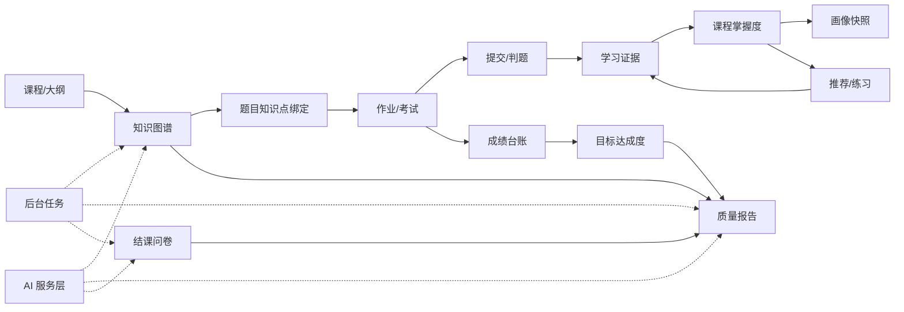

# 智学课堂（智学系统）项目结构与技术分析报告

> 分析对象：`D:/智学系统`（Git 分支 `dev`，189 次提交，工作区含未提交改动）
> 分析方式：静态代码审阅 + 目录/文件统计 + 关键链路代码核对；**未运行测试、构建或数据库迁移**
> 统计口径：以撰写时工作区文件为准，不含 `node_modules` 与构建产物
> 本文为撰写时的静态快照；迁移数、文件数和测试结论未随之后的提交自动更新，使用前应以当前代码和实际命令输出复核。

---

## 0. 结论速览

1. **产品定位**：面向管理员、教师、学生的 AI 个性化教学平台，当前以“Python 程序设计”单门课程做深完整教学闭环，V1.0 尚未整体验收。
2. **架构形态**：Next.js 15 App Router 单体 Web 应用 + 严格分层的 `services/` 领域层 + PostgreSQL；重任务拆为独立长任务 worker、判题 worker 和远程 gVisor 沙箱执行器。
3. **代码规模**：103 个页面、225 个 API 路由、229 个 React 组件、454 个服务层 TS 文件、121 个 Prisma 模型、76 个枚举、97 个迁移、301 个测试 TS 文件。
4. **最突出的设计**：全系统贯彻“**草稿 → 不可变审核修订 → 显式发布 → 当前指针**”的版本流水线，并用“输入指纹 + 规则版本 + 追加式修订”保证历史可复现。
5. **最突出的优点**：业务规则确定性优先（分数、权重、达成度、权限均由程序计算），AI 只做增强且必须可审核、可降级、可追溯。
6. **最大的结构性风险**：**学校隔离是后加的应用层约定**——仅 4 张表带 `schoolId`，而学号/工号是全局唯一，跨校数据边界依赖查询条件与 `School.admins` 关联，数据库层没有兜底。
7. **最大的安全缺口**：中间件只判断 Cookie 是否存在；API 无 CSRF 令牌、无速率限制、无 CSP/HSTS 等安全响应头；会话 7 天固定有效且无轮换。
8. **最大的工程风险**：单实例串行 worker、无协作式取消、唤醒依赖 `127.0.0.1`、可观测性仅 `console` + 数据库字段；迁移存在重复时间戳与非幂等 SQL。
9. **最大的体验债**：`components/` 中 15 个文件超过 700 行（最大 2071 行），52 处原生 `window.confirm`，18 处手写轮询，shadcn/ui 名义存在但只有 3 个基础组件。
10. **文档可信度**：项目对“已实现 / 已验证 / 已验收”的区分非常克制，这是优点；但 README、AGENTS、PROJECT-STATUS 三份状态文档存在版本与数量漂移（如迁移数 63 vs 97）。

---

## 1. 项目定位与角色模型

### 1.1 业务定位

平台围绕两条闭环展开：

**学生学习闭环**

```
教师建课/建题 → 学生作答 → 系统记录学习证据 → 更新学情画像
      ↑                                              ↓
      └──────── 针对性练习 ← 推荐/自主练习 ← 掌握度更新 ┘
```

**教师教学改进闭环**

```
导入名单 → 建立课程知识结构 → 采集成绩/出勤 → 分析班级学情与目标达成
     ↑                                                    ↓
     └──── 平台外审查 ← 教学质量报告 ← 结课问卷 ←──────────┘
```

### 1.2 四类角色

| 角色          | 入口                            | 核心权限                                                 | 边界                                 |
| ------------- | ------------------------------- | -------------------------------------------------------- | ------------------------------------ |
| `SUPER_ADMIN` | `/admin-login` → `/super-admin` | 合作学校、学校管理员、平台规模统计、开发日志             | 不参与具体教学业务                   |
| `ADMIN`       | `/admin-login` → `/admin`       | 本校用户、班级、题库分类、课程模板、公告、审计、系统配置 | 受 `schoolId` 约束，不能改绑其他学校 |
| `TEACHER`     | `/login` → `/teacher`           | 本人课程/班级/题目/作业/成绩/问卷/报告                   | 跨教师资源统一返回 404，避免枚举     |
| `STUDENT`     | `/login` → `/student`           | 本人课程、作业、练习、成绩、画像、问卷                   | 依赖 `ClassMembership` 判断在班状态  |

另有 `StudentIdentity`（待认领身份）这一“准用户”概念：名单导入先建身份与班级预分配，学生用“唯一学号 + 名单姓名”认领后才生成正式账号与 `ClassMembership`。

---

## 2. 技术栈与运行时拓扑

### 2.1 技术栈

| 层次      | 选型                                                                                |
| --------- | ----------------------------------------------------------------------------------- |
| 框架      | Next.js 15（App Router、Server Actions、Route Handlers）                            |
| UI        | React 19、Tailwind CSS 4、少量自定义 UI 组件、`react-force-graph-3d` + `three`      |
| 语言/校验 | TypeScript 5.9、Zod 3                                                               |
| 数据      | PostgreSQL 14+、Prisma 6                                                            |
| 文档处理  | `pdfjs-dist`（PDF 文本）、`word-extractor`、`pdf-lib`、`fflate`、`sharp`            |
| 报表      | Python（`python-docx`/`Pillow` 等，见 `services/quality-reports/requirements.txt`） |
| 测试      | Node `node:test` + `tsx`，独立 schema 的 PostgreSQL 集成测试                        |
| 部署      | Windows 计划任务 / Linux systemd；无容器编排                                        |

### 2.2 运行时拓扑

```
                        ┌──────────────────────────────┐
  Browser ────────────▶ │ Next.js Web (3000)           │
                        │  RSC 页面 + 225 个 API 路由   │
                        └───────┬──────────────┬───────┘
                                │              │
                    Prisma    │              │ HTTP + Bearer
                                ▼              ▼
                        ┌──────────────┐  ┌─────────────────────────┐
                        │ PostgreSQL   │  │ 长任务 Worker (唤醒 18789)│
                        │ 121 models   │  │ 8 类 AI/解析/报告任务     │
                        └──────▲───────┘  └─────────────────────────┘
                               │
                        ┌──────┴────────┐   HTTP    ┌──────────────────┐
                        │ 判题 Worker    │─────────▶│ Sandbox Executor │
                        │ 租约/重试/轮询 │          │ Docker + gVisor  │
                        └───────────────┘          │ 远程 8788/隧道    │
                                                   └──────────────────┘
```

- **Web 进程**只做请求处理与入队，不执行学生代码。
- **长任务 worker** 消费大纲解析、图谱生成/增强、题目映射、AI 出题、试卷解析、题目目标分类、质量报告等。
- **判题 worker** 消费 `PYTHON_JUDGE` / `PYTHON_PUBLIC_RUN` / `PYTHON_EXECUTION`，通过远程执行器跑隐藏用例。
- **沙箱执行器** 在 Linux 上以 Docker + `runsc` 运行，Web/worker 通过 SSH 隧道访问。

### 2.3 代码规模

| 指标                      | 数量                              |
| ------------------------- | --------------------------------- |
| `app/` 页面（`page.tsx`） | 103                               |
| API 路由（`route.ts`）    | 225                               |
| 布局（`layout.tsx`）      | 6                                 |
| `components/` TSX         | 229（约 5.2 万行）                |
| `services/` TS            | 454（约 7.8 万行），53 个领域目录 |
| Prisma model / enum       | 121 / 76                          |
| migration                 | 97                                |
| 测试 TS 文件              | 301（约 800 个 `test()` 声明）    |

---

## 3. 目录结构与分层职责

```
智学系统/
├─ app/
│  ├─ (auth)/            登录、管理员登录、学生认领注册
│  ├─ (protected)/       四类角色工作台（admin/teacher/student/super-admin）
│  ├─ api/               225 个 Route Handler，按角色与资源分域
│  ├─ actions/           仅 auth.ts、classrooms.ts 两个 Server Action
│  ├─ 403/ maintenance/  权限与维护模式兜底页
│  └─ layout.tsx loading.tsx error.tsx not-found.tsx
├─ components/           24 个业务域目录 + 少量 ui 基础件
├─ services/             领域服务层：校验、事务、审计、AI、任务
├─ lib/                  Prisma 单例、统一响应、错误映射、客户端 fetch
├─ prisma/               schema、97 个 migration、seed、超管引导
├─ tests/                单元/服务/HTTP 集成/独立库集成/UI 静态测试
├─ scripts/              演示数据、中国地图生成、沙箱能力验证
├─ deploy/               Windows 计划任务、systemd、沙箱 rootfs
├─ docs/                 验收记录、PRD、数据库设计、ADR、报告模板说明
├─ middleware.ts         仅做未登录跳转
└─ AGENTS.md / README.md / 项目计划书.md / CHANGELOG.md
```

### 3.1 分层调用规则

| 层             | 职责                                          | 约束                            |
| -------------- | --------------------------------------------- | ------------------------------- |
| 页面 / 路由    | 解析参数、鉴权、调用服务、渲染或返回 envelope | 不写业务规则；不直接访问 Prisma |
| `services/*`   | 业务规则、事务、归属校验、审计、幂等          | 唯一允许写数据库的层            |
| `lib/*-api.ts` | 把领域错误映射为 HTTP 状态与安全文案          | 不是客户端 SDK                  |
| `lib/api/*.ts` | 少量客户端 fetch 封装                         | 仅 3 个文件、7 个客户端组件使用 |
| `prisma`       | 数据访问                                      | `lib/prisma.ts` 单例            |

代表性路由 `app/api/teacher/assignments/route.ts`：

```ts
const parsed = assignmentUpsertSchema.safeParse(body);
if (!parsed.success) return apiError("请检查作业信息", 400, ...);
const teacher = await requireAuthenticatedUser([Role.TEACHER]);
return apiSuccess(await createDraftAssignment(teacher.id, parsed.data), 201);
```

注意：**参数校验发生在鉴权之前**，这是全项目较普遍的写法（详见 §8.1）。

---

## 4. 数据模型与“不可变”设计

### 4.1 领域分组

| 领域       | 代表模型                                                                                                                                            | 关键点                                       |
| ---------- | --------------------------------------------------------------------------------------------------------------------------------------------------- | -------------------------------------------- |
| 用户与学校 | `User`、`School`、`UserProfile`、`StudentIdentity`、`AuthSession`                                                                                   | 软删除 `deletedAt`；会话只存 `tokenHash`     |
| 课程与大纲 | `Course`、`CourseTemplate`、`CourseSyllabus`、`SyllabusParseDraft`、`SyllabusReviewRevision`、`PublishedSyllabusStructure`                          | `Course` 持有 4 个 `current*Id` 指针         |
| 知识图谱   | `KnowledgeGraphDraft`、`PublishedKnowledgeGraphVersion`、`KnowledgeGraphConcept`、`PublishedKnowledgeGraphNode/Edge`                                | `Concept.stableKey` 做跨版本稳定身份         |
| 题库       | `Question`、`QuestionOption`、`QuestionCourseCategory`、`QuestionKnowledgeGraphBinding*`                                                            | 题目带 `revision` 乐观锁与软删除             |
| 作业与考试 | `Assignment`、`AssignmentQuestion`（含 `*Snapshot` 字段）、`ExamSession`、`ExamPaperDraft`、`AssignmentMakeupGrant`                                 | 发布即冻结题面、分值、概念绑定、编程配置     |
| 提交与判题 | `Submission`、`StudentAnswer`、`ProgrammingAttempt`、`ProgrammingTestCaseResult`                                                                    | Attempt 追加式修订、隐藏用例结果不落库       |
| 成绩与出勤 | `CourseGradebook`、`GradeItem`、`StudentGradeEntryRevision`、`GradebookPublication`、`AttendanceRecordRevision`、`CourseOutcomeAttainmentRun`       | 修订号 + 输入指纹双唯一                      |
| 问卷与报告 | `CourseSurvey`、`CourseSurveyResponse`、`CourseSurveySummaryRevision`、`CourseQualityReport`                                                        | 匿名响应 `studentId = null`；报告双 checksum |
| 画像与推荐 | `LearnerProfileSnapshot`、`StudentCourseConceptMasteryRevision`、`CourseRecommendationCycle`、`CourseRecommendationPolicyRevision`、`LearningEvent` | 事件水位 + 规则版本 + 指纹                   |
| 任务与通知 | `BackgroundJob`、`BackgroundJobAttempt`、`Notification`、`Announcement`                                                                             | `idempotencyKey`、租约、去重键               |
| 审计与配置 | `AuditLog`、`SystemConfig`                                                                                                                          | 130+ `AuditAction` 枚举值                    |

### 4.2 三段式版本流水线

几乎所有“正式内容”都遵循同一模式：

```
上传/生成 → Draft（可失败、可重试）
          → ReviewRevision（不可变，revisionNumber 递增，expectedRevisionNumber 乐观锁）
          → PublishedVersion（不可变，versionNumber 递增）
          → Course.currentPublished*Id（指针切换）
```

覆盖对象：教学大纲、知识图谱、考核方案、成绩发布、问卷汇总、质量报告、掌握度、画像快照。

这带来三个直接收益：

1. **历史可复现**：已发布作业、成绩、报告不随题库或图谱更新而改写。
2. **并发可控**：修订号 + `Serializable` / `SELECT ... FOR UPDATE` 防止覆盖。
3. **幂等可查**：`inputFingerprint` 相同即复用，不重复生成。

### 4.3 快照与指纹清单（节选）

| 对象     | 冻结内容                                                         |
| -------- | ---------------------------------------------------------------- |
| 作业发布 | 题干、选项、答案、解析、分值、题序、概念绑定、编程配置、难度历史 |
| 成绩发布 | 学生行、成绩修订 ID、总评、考核分项、版本号                      |
| 达成度   | 输入快照、规则版本、公布 ID                                      |
| 质量报告 | 模板 checksum、源数据、统计结果、AI 文字、审核稿、DOCX checksum  |
| 问卷汇总 | 输入指纹、规则版本、不可变修订                                   |
| 画像     | 事件水位、输入指纹、修订号                                       |
| 掌握度   | 证据集合、规则版本、输入指纹、修订号                             |

### 4.4 学校隔离

- 仅 `User`、`CourseTemplate`、`QuestionCourseCategory` 直接带 `schoolId`；`Course`、`Question`、`Classroom` 通过教师/分类间接归属。
- 唯一约束仅 `[schoolId, code]`、`[schoolId, normalizedName]` 按校划分，且 `schoolId` 可空（NULL 不参与唯一）。
- `UserProfile.studentNo/teacherNo`、`StudentIdentity.studentNo` 是**全局唯一**。
- 权限判定示例：`services/questions/access.ts` 通过 `creator.school.admins.some({ id: userId })` 判断管理员是否属于该校。

这是全系统最需要优先加固的部分（见 §8.1）。

### 4.5 迁移历史分期

| 阶段       | 时间               | 主题                                                                           |
| ---------- | ------------------ | ------------------------------------------------------------------------------ |
| MVP        | 2026-07-13 ~ 07-23 | 初始化、认证、班级、题库、作业、分析、审计、通知                               |
| 迭代二/三  | 2026-07-29 ~ 07-31 | 课程与文件版本、名单导入、大纲解析/审核/发布                                   |
| 迭代四~六  | 2026-08-05 ~ 08-17 | 图谱、掌握度、考核方案、台账、出勤、达成度、任务、判题、画像、推荐、报告、问卷 |
| 长任务     | 2026-08-31         | 持久化 worker                                                                  |
| 迭代七     | 2026-10-06 ~ 10-28 | 学生端、教学进度、题库统一、AI 出题、补交、练习集                              |
| 多校与考试 | 2026-11-05 ~ 11-08 | School、目录分校、考试场次/试卷、课程通知、超管、难度下线                      |

存在 **6 组重复时间戳前缀**（如 `20261105090000` 同时用于 `admin_school_binding` 与 `assignment_categories`），Prisma 按目录名全序执行仍确定，但人工基线/脚本可能错序。

---

## 5. 模块职责与相互关系

### 5.1 领域模块职责表

| 模块                                                                                | 职责                                                   | 主要下游                           |
| ----------------------------------------------------------------------------------- | ------------------------------------------------------ | ---------------------------------- |
| `courses`                                                                           | 课程模板、教师课程、课程-班级绑定、课程文件            | 大纲、图谱、作业、台账、问卷、报告 |
| `syllabus-parsing`                                                                  | PDF 文本提取、AI 结构化、草稿、审核、发布              | 图谱、考核方案、问卷、考试目标     |
| `student-imports` / `student-identities` / `course-rosters`                         | 名单解析、映射、预览、待认领身份、认领入班、花名册维护 | 作业、成绩、出勤、问卷             |
| `knowledge-graph`                                                                   | 大纲→确定性节点/边 + AI `RELATED`、审核、发布          | 题目绑定、推荐、画像、学习中心     |
| `question-graph-bindings` / `concept-mastery`                                       | 题目主/次知识点绑定、证据→掌握度修订                   | 作业冻结、画像、推荐               |
| `questions` / `question-import` / `question-objectives`                             | 六类题型、课程分类共享题库、导入、课程目标映射         | 作业、考试、AI 出题                |
| `assignments` / `assignment-results`                                                | 草稿、发布快照、作答、提交、批改、公布、补交、撤回     | 证据、台账、画像、错题             |
| `programming-questions` / `programming-attempts`                                    | 编程题配置、公开运行、正式判题、重判/撤销              | 作业成绩、证据                     |
| `exams`                                                                             | 试卷解析、草稿审核、三年禁重、统一时窗、切屏、自动交卷 | 作业、台账                         |
| `gradebook` / `assessment-schemes` / `attendance` / `outcome-attainment`            | 考核方案、台账、导入、发布、签到、达成度               | 报告、学生成绩                     |
| `course-surveys` / `quality-reports`                                                | 问卷生成/发布/匿名汇总；报告快照/审核/DOCX             | 课程评价闭环                       |
| `learner-profiles` / `recommendations` / `course-recommendations` / `practice-sets` | 画像快照、推荐策略、练习组、提交                       | 学生学习中心                       |
| `learning-events`                                                                   | 统一学习事件与证据投影                                 | 掌握度、画像、推荐                 |
| `background-jobs` / `background-worker` / `programming-judge-worker`                | 任务队列、租约、重试、恢复                             | 所有长耗时能力                     |
| `ai`                                                                                | Provider 抽象、配置、超时、脱敏、降级                  | 大纲、图谱、出题、报告、试卷       |
| `notifications` / `announcements`                                                   | 站内通知、公告、去重、提醒任务                         | 全角色                             |
| `auth` / `system-config` / `audit` / `schools` / `super-admin`                      | 会话、授权、维护模式、审计、学校治理                   | 全部                               |

### 5.2 依赖关系



关键耦合点：

1. **`Course.currentPublished*Id` 是全局契约**：所有下游只读指针，不读草稿；指针被置空或指向旧版本会级联影响多个模块。
2. **`ClassMembership` 是“在班”的唯一口径**：作业、成绩、出勤、问卷都依赖它；名单导入只建 `StudentIdentityClassroomAssignment`，导入成功 ≠ 可收作业。
3. **`KnowledgeGraphConcept` 是课程级稳定身份**：跨图谱版本、题目绑定、作业快照、证据、掌握度都靠它衔接。
4. **`LearningEvent` 是画像与推荐的共同水源**：事件水位决定快照范围。

---

## 6. 核心执行流程

### 6.1 登录、会话与授权

```
/login → auth.ts loginAction
  → Zod 校验（邮箱/学号/工号，NFKC 归一）
  → bcrypt 比对（12 轮；空用户用 dummy hash 防时序探测）
  → createSession：32 字节随机 token，SHA-256 摘要入库
  → HttpOnly + SameSite=Lax + 7 天 Cookie
  → 跳转角色首页

每次请求：
middleware 仅检查 Cookie 存在
  → 角色 layout requirePageRole
  → 页面/路由 requireAuthenticatedUser([Role.X])
  → service 内以 teacherId/studentId 作为查询条件做归属过滤
  → 查不到统一 404
```

`requireAuthenticatedUser` 依次校验：身份 → 角色 → `mustChangePassword` → 维护模式。资源归属不在守卫里，而在各 service 的查询条件中。

### 6.2 课程建设与教学大纲发布

```
管理员建课程模板（本校）
  → 教师建课程（绑定本校题库分类）
  → 班级绑定课程（Classroom.courseId）
  → 上传 PDF 大纲：storage.save → CourseSyllabus(version+1, checksum)
  → POST /syllabus/parse：写 BackgroundJob（幂等键）
  → Worker：PDF 分页提文本 → AI 结构化 → Zod 校验 → 最多 2 次修复重试
  → SyllabusParseDraft（失败保留诊断与重试）
  → 教师逐页对照审核 → SyllabusReviewRevision（不可变，expectedRevision 乐观锁）
  → 显式发布：Serializable + FOR UPDATE
  → PublishedSyllabusStructure(version+1) → 切换 Course 指针
```

发布不自动覆盖旧版本；上传新 PDF 后旧正式版本仍可读，页面提示“来源已过期”。

### 6.3 名单导入与学生认领

```
教师上传名单（xlsx/csv）
  → 表头识别打分 → 字段映射 → 行级规范化 → 匹配已有用户/身份
  → 预览摘要（幂等键 = fileId + mappingHash）
  → 确认导入：CONFIRMED → PROCESSING 单飞抢占
  → 逐行建/更新 StudentIdentity + ClassroomAssignment
  → 学生 /register：学号 + 姓名认领（SELECT ... FOR UPDATE）
  → 建 User + ClassMembership(ACTIVE)
```

注意双轨：待认领阶段只有 `StudentIdentityClassroomAssignment`；花名册 ADD 对已注册用户则直接写 `ClassMembership`，绕过导入批次审计链。

### 6.4 主闭环：图谱 → 题目 → 作业 → 批改 → 掌握度

```
① 生成图谱：正式大纲 → 确定性节点/包含/先修 + AI RELATED
   → Draft → ReviewRevision → PublishedKnowledgeGraphVersion
   → Concept(courseId + stableKey) upsert → 切指针

② 题目绑定：教师选主/次知识点
   → 校验 graphVersionId === 当前正式版本
   → revision 乐观锁 → 记录来源图谱版本

③ 作业发布（事务内）：
   lockAssignmentLifecycle（班级/作业行锁）
   → 校验归属、状态、时间、题目非空、附件归属
   → replaceQuestionSnapshots（题干/选项/答案/分值/题序）
   → freezeAssignmentQuestionConcepts（RESOLVED / MISSING_FROM_PUBLISHED_GRAPH）
   → freezeAssignmentProgrammingConfigs（配置 hash、用例 hash）
   → status=PUBLISHED、totalPoints
   → 站内通知（同事务）

④ 学生作答：startOrResumeAttempt → saveStudentAnswers（草稿）
   → submitStudentAssignment（单飞 IN_PROGRESS→SUBMITTED）
   → 客观题即时判分；简答/编程 PENDING_REVIEW
   → 错题 upsert

⑤ 教师批改：人工评分 → 追加 StudentAnswerConceptEvidence 修订
   → appendAssessmentLearningEventsAndProjectEvidence
   → recalculateStudentCourseConceptMastery
      （FOR UPDATE + inputFingerprint 去重 + 追加 revision，阈值 50/80）
   → 公布成绩（作业级）

⑥ 下游：掌握度 → 画像快照 → 推荐周期 → 练习组 → 新证据（回到 ⑤）
```

### 6.5 编程题判题

```
创建 Attempt（与 PYTHON_JUDGE 任务同事务）
  → 冻结配置快照：configurationHash / testCasesHash / executorRuleVersion
  → 判题 worker claim 租约（30s）
  → GET /api/internal/programming-attempts/:id/payload（含隐藏用例）
  → 逐用例 executor.submit（requestId 确定性去重）
  → 沙箱：Docker + runsc，--network none、只读根、cap-drop ALL、
          pids/内存/CPU/输出/超时限制、nobody 用户、python3 -I -B -S
  → 服务端重算 stdout === expected（不信任 worker 的 passed）
  → 用例不完整或 INTERNAL_ERROR → 409，不投影成绩
  → 仅 PUBLIC 用例保存 stdout/stderr，隐藏用例置 null
  → 投影 StudentAnswer、学习事件、推荐练习分
```

### 6.6 考试

```
上传试卷（DOC/DOCX/PDF/TXT/JSON）→ 长任务解析（可含视觉模型）
  → ExamPaperDraft + 诊断 + 页面图像
  → 教师逐题修改/删题/设目标/裁图/排序 → 批量确认（事务，任一不合格整批失败）
  → 发布：权限 + 修订 + 三年禁重（contentHash + ExamQuestionUse）
  → 冻结每题课程目标与大纲版本；同题复用共享题库
  → 每班生成 Assignment（publishedAt=startsAt，dueAt=endsAt）并立即发布
  → 学生开考 → 切屏记录（eventKey 幂等）→ 超限自动交卷
  → 到点 expiry 扫描自动交卷 → 成绩同步台账
```

### 6.7 成绩台账与目标达成度

```
正式大纲 → 考核方案草稿 → 教师审核权重/目标分配/阈值
  → PublishedAssessmentScheme（不可变，calculationRuleVersion）
  → 台账：平台作业同步 / 人工录入 / 十列模板导入
  → 校验作业类别 ↔ 考核组件、等权、来源一致
  → 逐生 calculateStudentGradeInTransaction → GradeRevision（指纹去重）
  → 发布：全员重算 → GradebookPublication(version+1) + 学生行快照
  → 达成度：publicationId + ruleVersion 唯一，输入快照，缺项 EXCLUDED_MISSING
```

### 6.8 结课问卷与质量报告

```
正式大纲 → 问卷草稿（课程目标自评 + 五级量表 + 开放题）
  → 教师改题/时间/实名或匿名 → 立即或预约发布
  → 学生一次性提交
  → 匿名：Participation 记名去重，Response.studentId = null
  → 汇总：< 5 份只显示人数/响应率；≥ 5 生成不可变 SummaryRevision
  → 开放题去标识后确定性主题统计

报告：
  平台台账 或 上传 xlsx/csv（不回写正式成绩）
  → 冻结模板 checksum + 映射 + 源数据 + 统计 + 规则版本
  → 通用后台任务生成
  → AI 文字（去标识化统计）或确定性兜底
  → 教师逐项审核 → 正式 DOCX/XLSX 私有下载
```

### 6.9 长任务调度

```
业务请求 → createBackgroundJob（type + idempotencyKey + inputFingerprint）
  → after() 向 127.0.0.1:18789/wake 发可丢失唤醒（1s 超时）
  → worker 每 2s 轮询 claim：
     Serializable 事务 findFirst(PENDING, lease=null, nextAttemptAt<=now)
     → updateMany 以 attemptCount + currentLeaseId 做 CAS
  → 心跳续租（120s）→ 进度写库 → Web 轮询展示
  → 成功 complete / 失败指数退避（1s→300s，上限）
  → 30s 扫描过期租约：归还 PENDING 或 FAILED(LEASE_EXPIRED)
```

### 6.10 画像与推荐

```
LearningEvent（提交/批改/练习/出勤/反思）
  → 画像快照：当前正式图谱 + 最新掌握度修订 + 事件水位 + 已关闭考勤
  → 指纹快照（未评估单列，不按零分）
  → 推荐：课程正式图谱 + 教学进度 + 六项确定性策略（ruleVersion）
  → 候选打分（薄弱/先修/错因/新鲜度）→ reasonCodes
  → 练习组提交 → 新证据 → 掌握度 → 下一轮
```

---

## 7. 关键技术点

1. **服务层集中业务规则**：页面与路由只做参数、鉴权、编排；事务、归属、审计、幂等都在 `services/`。
2. **不可变版本链**：`Draft → ReviewRevision → PublishedVersion → 指针`，历史快照永不改写。
3. **输入指纹幂等**：成绩、掌握度、画像、问卷汇总、报告均以 `inputFingerprint` 去重，重复计算返回旧修订。
4. **并发控制组合拳**：`Serializable` + 重试、`SELECT ... FOR UPDATE`、`revision` 乐观锁、`updateMany` 单飞抢占。
5. **作业发布冻结**：题面、分值、题序、概念绑定、编程配置一次性固化，后续题库/图谱变化不影响历史。
6. **追加式证据**：批改、重判、撤销都生成新修订，`supersedesEvidenceId` 串成链，不覆盖历史。
7. **AI 只做增强**：统一 `AIProvider` 接口、严格 Zod 校验、修复重试、确定性降级、伪名化与文本脱敏。
8. **判题结果服务端复算**：不信任执行器 `passed`，隐藏用例输出不落库，系统错误不投影为零分。
9. **沙箱纵深防御**：gVisor + 只读根 + 无网络 + cap-drop + 资源限额 + 非 root + 确定性环境变量。
10. **匿名问卷物理隔离**：参与记录与回答记录分离，匿名回答不存学生 ID；小样本抑制。
11. **长任务租约模型**：心跳、过期恢复、指数退避、幂等键，避免重复写入。
12. **前端 URL 即状态**：筛选、分页、范围、返回锚点大多放查询参数，服务端校验后渲染，便于恢复与分享。
13. **测试数据库隔离**：集成测试要求独立 `TEST_DATABASE_URL`，随机 schema，`finally` 清理。
14. **文档分级表述**：明确区分“实现存在 / 专项测试通过 / 用户验收 / V1.0 整体验收”，避免过度宣称。

---

## 8. 问题与需要关注的边界

> 严重度：**P0** 安全或数据边界；**P1** 一致性与可靠性；**P2** 体验与维护性。

### 8.1 安全与权限

| #   | 问题                   | 证据                                                                                                                                          | 影响                                                               | 建议                                                                               |
| --- | ---------------------- | --------------------------------------------------------------------------------------------------------------------------------------------- | ------------------------------------------------------------------ | ---------------------------------------------------------------------------------- |
| 1   | 学校隔离仅应用层       | 仅 4 表带 `schoolId`；`UserProfile.studentNo`、`StudentIdentity.studentNo` 全局唯一；`services/questions/access.ts` 依赖 `School.admins` 非空 | 跨校学号冲突；管理员解绑后全校题库访问可能失效；漏加过滤即跨校泄露 | 核心表补 `schoolId`；唯一键改复合；DB 级约束/RLS；隔离判定改为直连 `user.schoolId` |
| 2   | 中间件只判 Cookie 存在 | `middleware.ts:5-20`                                                                                                                          | 伪造 Cookie 可通过中间件；`/api/*` 不在 matcher，完全依赖路由自觉  | 明确中间件非安全边界；为所有 API 建立统一 guard；考虑签名/加密 Cookie              |
| 3   | 无 CSRF 防护           | 全仓库无 Origin/Referer 校验与 CSRF token                                                                                                     | 依赖 `SameSite=Lax`，跨站写操作仍有窗口                            | 写接口校验 Origin；或引入双提交 token                                              |
| 4   | 无速率限制             | 登录、注册、AI、判题接口均无限流                                                                                                              | 暴力破解、批量注册、资源耗尽                                       | 登录/注册/IP/用户维度限流；AI 与判题配额                                           |
| 5   | 无安全响应头           | `next.config.ts` 仅图片域名                                                                                                                   | 点击劫持、XSS 缓解不足                                             | 增加 CSP、HSTS、`X-Frame-Options`、`Referrer-Policy`                               |
| 6   | 会话无轮换/无上限      | `createSession` 不清理旧会话；7 天固定过期                                                                                                    | 会话长期有效、无法统一踢出                                         | 登录轮换、并发上限、滑动续期、管理端强制下线                                       |
| 7   | 参数校验先于鉴权       | `app/api/teacher/assignments/route.ts:9-20`                                                                                                   | 未认证请求可探测 schema、消耗解析                                  | 先鉴权再解析，或统一中间件                                                         |
| 8   | 公开资源路由           | `app/api/super-admin/schools/[schoolId]/logo` 无鉴权                                                                                          | 学校 ID 枚举、带宽滥用                                             | 加缓存与尺寸限制；必要时签名 URL                                                   |

### 8.2 数据一致性与版本边界

| #   | 问题                 | 证据                                                                                                | 影响                                                      |
| --- | -------------------- | --------------------------------------------------------------------------------------------------- | --------------------------------------------------------- |
| 9   | 当前指针 `SetNull`   | `Course.currentPublished*Id` 均 `onDelete: SetNull`                                                 | 删除已发布版本会静默降级为“无当前版本”                    |
| 10  | 大纲指针不随上传清空 | 上传新 PDF 只增版本，靠 `isCurrentPublishedStructureStale` 事后识别                                 | 下游可能继续消费旧结构；考试只比 `structureId`            |
| 11  | 绑定严格、冻结宽松   | 绑定要求图谱版本全等；冻结允许旧绑定按 `conceptId` 解析或标记 MISSING                               | 同题跨作业证据覆盖不一致                                  |
| 12  | 证据早于成绩公布     | `services/learning-events/assessment.ts` 在批改时写事件；画像聚合未见 `publishedAt` 过滤            | 画像/掌握度可能反映尚未公布的成绩                         |
| 13  | 匿名问卷 DB 唯一无效 | `CourseSurveyResponse.@@unique([surveyId, studentId])`，匿名时 `studentId` 为 NULL                  | 去重完全依赖应用层 `Participation`，绕过服务即可能重复    |
| 14  | 可空列参与唯一       | `CourseFileVersion` 的 `courseId/classroomId` 可空                                                  | 班级文件版本号可能重复                                    |
| 15  | 软删除与唯一冲突     | `AIQuestionGenerationBatch.idempotencyKey`、`PracticeSetManagement.@@unique([studentId, cycleKey])` | 软删后同键无法重建                                        |
| 16  | Schema 与迁移漂移    | 部分唯一索引、索引名（`_upd_id` vs `_upd_idx`）未在 schema 表达                                     | `prisma migrate dev` 可能生成删改索引                     |
| 17  | 双在班模型           | `StudentIdentityClassroomAssignment` vs `ClassMembership`                                           | 导入成功但未认领的学生不可收作业；花名册 ADD 绕过批次审计 |
| 18  | 规则版本分散         | 掌握度、成绩、达成度、报告各自常量                                                                  | 升级不同步会导致快照口径漂移                              |

### 8.3 工程与可靠性

| #   | 问题                          | 证据                                          | 影响                                 |
| --- | ----------------------------- | --------------------------------------------- | ------------------------------------ |
| 19  | 单 worker 串行                | `services/background-worker/worker.ts` 单循环 | 一个长 AI 任务阻塞全部队列           |
| 20  | 取消非协作                    | `cancelBackgroundJob` 只改状态                | 正在执行的 AI/解析不会真正停止       |
| 21  | 唤醒依赖本机                  | `after()` POST `127.0.0.1:18789`              | 多机/容器部署失效，只能靠轮询        |
| 22  | 领取用 CAS 而非 `SKIP LOCKED` | `Serializable` + `updateMany`                 | 高并发下重试耗尽返回 null，空轮询    |
| 23  | 本地磁盘存储                  | `services/storage/local.ts`                   | 多实例不共享；容量与备份压力；无加密 |
| 24  | 文件保留期不完整              | 仅 AI 出题源文件有 `sourceFileExpiresAt`      | 作业附件、课程文件、报告长期堆积     |
| 25  | 可观测性不足                  | 仅 `console.error` JSON + DB 字段             | 无指标、无 trace、无告警；故障定位慢 |
| 26  | 日志无轮转                    | Windows `.data/.../logs`                      | 长期运行占满磁盘                     |
| 27  | 无备份/恢复脚本               | README 仅要求手工备份                         | 迁移或事故恢复依赖人工               |
| 28  | 无健康探针自动重启            | 计划任务 `IgnoreNew`，无失败重启              | worker 挂掉后需人工拉起              |

### 8.4 测试与交付

| #   | 问题                       | 证据                                                                                                                                       | 影响                                     |
| --- | -------------------------- | ------------------------------------------------------------------------------------------------------------------------------------------ | ---------------------------------------- |
| 29  | 服务测试直连开发库         | 至少 10 个 `*.test.ts` 直接 `new PrismaClient()`，默认读 `DATABASE_URL`                                                                    | 可能污染开发数据、改写 seed 账号密码     |
| 30  | CI 覆盖不全                | `.github/workflows/ci.yml` 未跑 `prisma validate`、`migrate status`、`test:teaching-workflows`、`test:super-admin`、`test:exams`、沙箱能力 | “CI 绿”不等于全量门禁                    |
| 31  | HTTP 套件共享端口          | 13 个套件串行复用 3100                                                                                                                     | 残留进程导致 `EADDRINUSE`                |
| 32  | 迁移重复时间戳             | 6 组同前缀目录                                                                                                                             | 人工基线/脚本可能错序                    |
| 33  | 迁移含非幂等/硬编码        | `md5()` 克隆目录、硬编码 NUIST 学校、按 id 正则删目录、事务内 `ALTER TYPE`                                                                 | 重跑或回滚风险                           |
| 34  | 文档数量漂移               | README/PROJECT-STATUS 称 63 个迁移，实际 97                                                                                                | 误导后续维护者                           |
| 35  | 工作区未提交改动           | `git status` 显示考试自动组卷相关 8 个文件                                                                                                 | 新功能未纳入文档与基线，易被误判为已完成 |
| 36  | `.gitignore` 忽略 `/docs/` | 已跟踪 27 个文档不受影响，但新文档默认不入库                                                                                               | 文档与代码版本继续分叉                   |

### 8.5 前端与体验

| #   | 问题               | 证据                                                                    | 影响                                      |
| --- | ------------------ | ----------------------------------------------------------------------- | ----------------------------------------- |
| 37  | 超大客户端组件     | `assignment-form.tsx` 2071 行、32 个 `useState`；另有 14 个 >700 行     | 维护困难、重渲染、测试难                  |
| 38  | 设计系统名存实亡   | `components/ui/` 仅 3 个文件；`bg-sky-*` 659 次、`bg-white` 512 次      | 视觉不一致、改版成本高                    |
| 39  | 原生确认框         | `window.confirm` 52 处                                                  | 阻塞、不可定制、与 `<dialog>` 混用        |
| 40  | 手写轮询           | 18 处 `setInterval`，无退避/无页面隐藏暂停                              | 后台标签页持续请求                        |
| 41  | Suspense 缺失      | 103 页仅 4 处 `<Suspense>`                                              | 重客户端页无流式骨架                      |
| 42  | Toast 只挂教师布局 | `ToastHost` 仅在 `teacher/layout.tsx`                                   | 其他角色提示静默失效                      |
| 43  | 学生课程根路由缺失 | `student/courses/[courseId]/` 无 `page.tsx`                             | 直接访问 404，只能经 learning-center 跳转 |
| 44  | 硬编码课程名       | 图谱页 `title="Python 课程知识图谱"`                                    | 多课程时文案错误                          |
| 45  | 三维图谱无降级     | 仅 CHAPTER/SPHERE 两种 3D 布局，无 2D/列表；无 `prefers-reduced-motion` | 低性能设备与无障碍体验风险                |
| 46  | 重复实现           | `requestJson` 两份、4 个角色 layout 复制 shell、分页组件两套            | 修一处漏三处                              |

### 8.6 产品与验收边界

- **V1.0 未整体验收**：README、AGENTS、PROJECT-STATUS 一致声明；已有的是 MVP 与迭代一至六专项、以及问卷/报告/学生端增量专项。
- **完整三角色浏览器 E2E 未封口**：部分确认弹窗由同服务层测试替代，不能表述为完整自动浏览器验收。
- **目标环境恢复未演练**：worker 重启/租约接管、备份恢复、部署回滚仍待验证。
- **考试专项**：切屏检测有浏览器技术边界，尚未经三角色整体验收。
- **密集图谱性能**：未做专项压测与无障碍替代验收。

---

## 9. 建议的改进优先级

### P0（1~2 个迭代内）

1. **租户加固**：给 `Course/Classroom/Question/Submission` 等核心表补 `schoolId`，唯一键改复合；把 `School.admins` 关联判定改为 `user.schoolId` 直连；为跨校查询加自动化测试。
2. **认证与 API 加固**：登录/注册限流、写接口 Origin 校验、安全响应头、会话轮换与并发上限；统一“先鉴权后解析”。
3. **修复数据库约束漏洞**：匿名问卷去重、可空唯一列、软删除唯一键；补 `prisma validate` 与 `migrate status` 到 CI。

### P1（1~2 个月）

4. **版本指针不变量**：禁止删除已发布版本；上传新大纲时显式标记旧指针 stale 并在所有下游统一校验；把“指针必须指向当前有效版本”做成启动/定时自检。
5. **worker 可靠性**：多 worker 并发、`FOR UPDATE SKIP LOCKED`、协作式取消、死信队列与告警；唤醒改为可配置消息队列或数据库通知。
6. **可观测性**：结构化日志 + 请求 ID + 关键指标（队列深度、任务时长、AI 失败率、判题错误率）+ 告警。
7. **文件生命周期**：统一保留期、孤儿清理、容量监控、对象存储抽象。
8. **测试隔离**：把服务测试全部切到 `TEST_DATABASE_URL`，CI 覆盖教学流程/考试/超管/沙箱。

### P2（持续）

9. **前端拆分**：`assignment-form`、`ai-question-workspace`、`quality-report-workspace` 按步骤/子域拆分；统一 `usePolling`、`ConfirmDialog`、数据请求层。
10. **设计系统落地**：补齐 button/input/table/dialog/select，收敛 `bg-sky-*` 与硬编码颜色。
11. **文档收敛**：以 `docs/PROJECT-STATUS.md` 为唯一状态源，README 只保留入口与边界；自动校验迁移数量与脚本清单。
12. **体验补齐**：学生课程根路由、图谱 2D/列表降级、Suspense 骨架、Toast 全角色挂载。

---

## 10. 关键文件索引

| 主题           | 文件                                                                                             |
| -------------- | ------------------------------------------------------------------------------------------------ |
| 项目约束与基线 | `AGENTS.md`、`项目计划书.md`、`README.md`                                                        |
| 当前状态与证据 | `docs/PROJECT-STATUS.md`、`CHANGELOG.md`                                                         |
| 数据模型       | `prisma/schema.prisma`（121 model / 76 enum）                                                    |
| 认证与会话     | `services/auth/session.ts`、`authorization.ts`、`policy.ts`                                      |
| 统一响应       | `lib/api-response.ts`、`lib/zod-errors.ts`、`lib/*-api.ts`                                       |
| 作业主链路     | `services/assignments/service.ts`（发布 `publishInTransaction`、提交 `submitStudentAssignment`） |
| 批改与证据     | `services/assignments/manual-grading.ts`、`services/learning-events/assessment.ts`               |
| 掌握度         | `services/concept-mastery/service.ts`                                                            |
| 知识图谱       | `services/knowledge-graph/generator.ts`、`service.ts`                                            |
| 大纲解析       | `services/syllabus-parsing/service.ts`、`review-service.ts`                                      |
| 名单导入       | `services/student-imports/service.ts`、`services/student-identities/`                            |
| 判题           | `services/programming-attempts/service.ts`、`services/programming-judge-worker/src/worker.ts`    |
| 沙箱           | `services/sandbox-executor-server/src/runner.ts`                                                 |
| 长任务         | `services/background-jobs/repository.ts`、`services/background-worker/worker.ts`                 |
| AI             | `services/ai/provider.ts`、`openai-compatible.ts`、`analyzer.ts`、`privacy.ts`                   |
| 成绩与达成度   | `services/gradebook/service.ts`、`services/outcome-attainment/service.ts`                        |
| 问卷与报告     | `services/course-surveys/summary.ts`、`services/quality-reports/service.ts`                      |
| 画像与推荐     | `services/learner-profiles/service.ts`、`services/course-recommendations/`                       |
| 前端壳与导航   | `components/dashboard/dashboard-shell.tsx`、各角色 `layout.tsx`                                  |
| 部署           | `deploy/windows-local/README.md`、`deploy/*/*.service`、`start-all.ps1`（本地未跟踪）            |
| CI             | `.github/workflows/ci.yml`                                                                       |
| 测试隔离       | `tests/integration/database.ts`                                                                  |

---

## 11. 一句话总结

这是一个**业务复杂度高、领域建模认真、历史不可变设计出色**的教学平台：它把“谁在什么状态下能对哪份数据做什么”拆成了版本、快照、证据、审计四条主轴；但**多校隔离是后加的、认证边界偏薄、异步与运维仍是单机假设**，这三处决定了它距离“可对外生产”还有明显距离。当前最合理的推进方式不是继续加功能，而是先封口租户隔离、认证加固、worker 可靠性与全量自动门禁。
